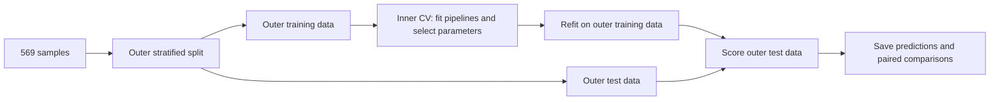

# Breast Cancer Classification and Exploratory Data Mining

**English** | [简体中文](README.zh-CN.md)

A reproducible Python extension of a medical data-mining course project using
the Wisconsin Diagnostic Breast Cancer dataset. It combines benign–malignant
classification, nuclear-feature analysis, and exploratory clustering.

## Project background

The original course project investigated whether quantitative measurements of
cell nuclei could distinguish benign from malignant breast-mass samples. Its
analysis used features already extracted from fine-needle aspirate (FNA) images:
nuclear size, boundary shape, and gray-scale texture. This provides a concrete
biomedical classification task in which predictions can be examined alongside
the measured characteristics of the samples.

The coursework compared five classification families, examined feature
correlations and random-forest feature importance, and explored sample groupings
through clustering and PCA. The questions were how well the classifiers separated
the two diagnoses, which measurements contributed to prediction, and how the
unsupervised groupings related to the known labels.

This repository extends that analysis with a reproducible evaluation workflow
and a probability-weighted voting experiment. It tests whether combining models
improves on an individually selected classifier when both are evaluated on the
same unseen outer folds. Model tuning stays inside the training data, and the
exported predictions support direct comparisons between methods.

## Dataset

The project uses **Wisconsin Diagnostic Breast Cancer (WDBC)** from the
[UCI Machine Learning Repository](https://doi.org/10.24432/C5DW2B).
Each row describes a breast-mass sample using measurements of cell nuclei in a
digitized FNA image. The model inputs are the supplied numeric measurements;
image segmentation and feature extraction were performed by the dataset creators.

| Property | Description |
| --- | --- |
| Samples | 569 |
| Diagnosis labels | 357 benign (`B`), 212 malignant (`M`) |
| Predictors | 30 continuous features: 10 measurements × 3 summary statistics |
| Missing feature values | None |
| Original file structure | Sample ID, diagnosis, and 30 feature columns |
| Repository data loader | `sklearn.datasets.load_breast_cancer`, with malignant mapped to `1` and benign to `0` |

The sample ID is excluded from the predictors, and diagnosis is used only as
the target. All 30 features are retained for classification. PCA is used for
exploratory visualization; its components are not used as classifier inputs.

## Features studied

The ten underlying measurements describe nuclear size, texture, and boundary
structure. Their definitions follow the dataset's accompanying `wdbc.names`
description, supplied with the original course code.

| Measurement | What it describes |
| --- | --- |
| Radius | Average distance from the nuclear center to its boundary |
| Texture | Variation in image intensity, measured by the standard deviation of gray-scale values |
| Perimeter | Length of the nuclear boundary |
| Area | Area enclosed by the nuclear boundary |
| Smoothness | Local variation in distances from the center to the boundary |
| Compactness | A shape measure based on the relationship between perimeter and area |
| Concavity | Severity of inward-curving portions of the boundary |
| Concave points | Number of concave portions of the boundary |
| Symmetry | Symmetry of nuclear shape |
| Fractal dimension | Complexity of the nuclear boundary, based on a coastline approximation |

For each measurement, the dataset records three summaries across the nuclei in
the image: the **mean**, the **standard error (SE)**, and the **worst value**.
In WDBC, **worst is the mean of the three largest values**. These summaries
produce the following 30 columns, shown with the exact names used in this code:

| Mean | Standard error | Worst |
| --- | --- | --- |
| `mean radius` | `radius error` | `worst radius` |
| `mean texture` | `texture error` | `worst texture` |
| `mean perimeter` | `perimeter error` | `worst perimeter` |
| `mean area` | `area error` | `worst area` |
| `mean smoothness` | `smoothness error` | `worst smoothness` |
| `mean compactness` | `compactness error` | `worst compactness` |
| `mean concavity` | `concavity error` | `worst concavity` |
| `mean concave points` | `concave points error` | `worst concave points` |
| `mean symmetry` | `symmetry error` | `worst symmetry` |
| `mean fractal dimension` | `fractal dimension error` | `worst fractal dimension` |

Here, `error` denotes standard error, not prediction error.

The course report and presentation highlighted `concavepoints_worst`,
`radius_worst`, and `area_se` in their random-forest importance analysis. Their
equivalents are `worst concave points`, `worst radius`, and `area error`.
The current benchmark evaluates all 30 features and exports new importance
estimates for each outer fold in
[feature_importance_summary.csv](results/reference/feature_importance_summary.csv).

## Reference experiment

**Read the [reference experiment](results/reference/report.md)** for the measured
results, paired comparisons, feature analysis, and plots.
中文运行说明和项目讲解见 [项目说明](docs/PROJECT_NOTES_ZH.md)。

The included full run produced these outer-fold means:

| Procedure | Accuracy | ROC AUC | Malignant F1 |
| --- | ---: | ---: | ---: |
| Inner-selected single model | 97.37% | 0.9952 | 0.9633 |
| Probability-weighted voting | 97.72% | 0.9954 | 0.9688 |

Voting increased mean accuracy by approximately 0.35 percentage points. This is a
small descriptive gain, not evidence of a significant improvement. The report
includes fold variability and the complete paired comparisons. These are new
October 2026 extension results and should not be confused with the earlier course
report's metrics.


## What is included

- Five classification families: Gaussian naive Bayes, logistic regression, RBF SVM,
  decision tree, and random forest.
- A soft-voting ensemble of logistic regression, SVM, and random forest, with
  relative weights selected by inner cross-validation.
- Stratified 5-fold outer evaluation and 3-fold inner model selection. All methods
  share the same outer partitions; scalers live inside the model pipelines.
- Accuracy, ROC AUC, average precision, malignant-class F1, recall, and precision.
- Per-fold predictions, split indices, model settings, package versions, and hashes.
- Random-forest impurity and held-out permutation feature importance.
- Exploratory IQR outlier detection, Spearman correlations, K-means, Ward clustering,
  DBSCAN, Gaussian mixtures, and a two-component PCA display.
- Automated tests for the evaluation boundaries and a GitHub Actions smoke test.

## Quick start

Use Python 3.11–3.13. The reference run was generated with Python 3.13 and the pinned
versions in `requirements.txt`. Run these commands from the repository root.

```bash
python -m venv .venv
```

Activate on Windows PowerShell:

```powershell
.\.venv\Scripts\Activate.ps1
```

On macOS or Linux:

```bash
source .venv/bin/activate
```

Then install dependencies and run:

```bash
python -m pip install -r requirements.txt
python -m unittest discover -s tests -v
python -m wdbc_ml --output results/my-run
```

The dataset is bundled with scikit-learn. No network access is needed after
dependencies are installed. The command produces a Markdown report, CSV/JSON
evidence, and three PNG figures. Model files are not required to reproduce the
experiment.

For a fast installation check:

```bash
python -m wdbc_ml --quick --output results/smoke
```

`--quick` reduces both fold counts to two, truncates search grids, and reduces tree
counts. Its output is labeled as a smoke test and is not comparable to the full
reference experiment. Existing result directories are protected; pass
`--overwrite` explicitly to replace their generated files.

## Evaluation protocol

1. Load 569 samples with 30 numeric features. Set malignant to 1 and benign to 0.
2. Make the outer stratified splits before fitting any predictive transformation.
3. In each outer training partition, use inner stratified CV to select each
   model's hyperparameters by ROC AUC. Scaling is fitted independently in each
   inner training fold and then refitted on the complete outer training partition.
4. Select the `selected_single` comparator using the inner-CV scores only.
   Separately select the voting weights from `(1,1,1)`, `(2,1,1)`, `(1,2,1)`, and
   `(1,1,2)`, ordered as logistic regression, SVM, random forest. Voting members
   have fixed base-model settings, so this experiment searches only their weights.
5. Score all fitted candidates on the same outer test partition at the fixed
   malignant-probability threshold of 0.5. Do not choose thresholds, weights,
   features, or model settings from these outcomes.
6. Report outer-fold means, sample standard deviations, and paired differences.



`selected_single` may use a different family in each outer fold. It estimates a
selection procedure and is not the same as retrospectively picking the largest
outer-CV mean. The soft-voting experiment need not beat this comparator. SVM
probability estimation uses training-only internal calibration through libsvm;
the reported outer-test samples never participate in it. Scaling for that
calibration is shared within the pipeline's training partition, not refitted in
each of libsvm's internal calibration splits.

The IQR analysis counts unusual observations without deleting or capping them.
Clustering and PCA use all samples in a separate exploratory analysis; they do
not feed derived features or cluster labels into the supervised benchmark.
DBSCAN noise is excluded from internal clustering metrics and reported as a
coverage loss. Cluster labels are arbitrary, not diagnoses.

## Repository layout

```text
wdbc_ml/
  __main__.py       command-line entry point and run metadata
  data.py           dataset loading, class mapping and fingerprint
  models.py         model pipelines and predefined search spaces
  evaluation.py     nested CV, metrics, predictions and feature importance
  exploration.py    descriptive analysis, clustering and PCA
  reporting.py      tables, figures and Markdown report
tests/              evaluation-integrity tests
docs/               Chinese guide and provenance notes
results/reference/  full reference run with machine-readable evidence
.github/workflows/  automated tests and smoke run
```

## Reading and reproducing the results

`results/reference/metadata.json` identifies the versions, seed, data fingerprint,
and source-code hashes used for the included run. `fold_metrics.csv` contains the
individual outer-fold scores. `searches.json` records the grids and selected
settings; `splits.json` records every training, validation, and test row index.
`paired_differences.csv` is voting minus the inner-selected comparator on the same
fold. Feature-importance CSVs distinguish impurity importance from permutation
AUC decrease.

Numeric CSVs retain 17 significant digits. To recompute probability-ranking
metrics in pandas, load them with `pd.read_csv(path, float_precision="round_trip")`;
rounding near-one probabilities can otherwise introduce ties and alter AUC or
average precision.

All random estimators have explicit seeds. The reference command uses one worker
and limits numerical thread pools to one. Exact last-decimal agreement can still
depend on the Python version, library builds, and operating system. The tests
check repeatability in one environment; they do not promise bitwise equality
between operating systems.

This benchmark reuses a small public dataset that has already been inspected in
coursework. Nested CV improves evaluation discipline but is not external clinical
validation. Fold-to-fold standard deviations are not confidence intervals.
Feature rankings describe model behavior and can be affected by correlated inputs.

## Data, provenance and license

Data: [UCI Breast Cancer Wisconsin (Diagnostic)](https://doi.org/10.24432/C5DW2B),
569 observations and 30 features, released by UCI under
[CC BY 4.0](https://creativecommons.org/licenses/by/4.0/).
Features describe cell nuclei in digitized fine-needle aspirate images.
Method references:

- [scikit-learn: avoiding data leakage](https://scikit-learn.org/stable/common_pitfalls.html#data-leakage)
- [scikit-learn: nested cross-validation](https://scikit-learn.org/stable/auto_examples/model_selection/plot_nested_cross_validation_iris.html)
- [scikit-learn: VotingClassifier](https://scikit-learn.org/stable/modules/generated/sklearn.ensemble.VotingClassifier.html)
