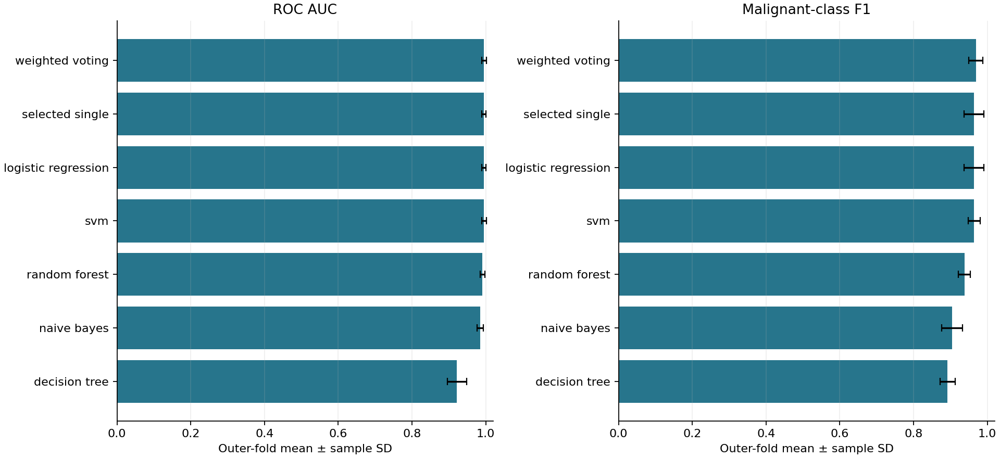
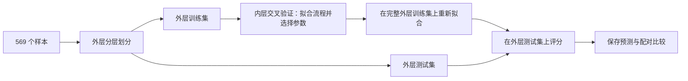

# 乳腺癌分类与探索性数据挖掘

[English](README.md) | **简体中文**

本项目基于威斯康星乳腺癌诊断数据集，将医学数据挖掘课程项目扩展为可复现的 Python 分析流程，涵盖良恶性分类、细胞核特征分析与探索性聚类。

## 项目背景

本项目研究细胞核的定量测量指标能否用于区分乳腺肿块样本的良恶性。分析使用数据集已提供的细针穿刺（fine-needle aspiration，FNA）图像特征，包括细胞核大小、边界形态和灰度纹理。通过这一生物医学分类任务，可以结合样本的实际测量指标分析模型预测。

课程项目比较了五类分类算法，分析了特征相关性和随机森林特征重要性，并通过聚类和主成分分析（PCA）探索样本分布。重点关注三个问题：不同分类器区分良恶性样本的表现如何，哪些测量指标对预测贡献较大，以及无监督聚类形成的分组与已知诊断标签有何关系。

本仓库在上述分析基础上增加了可复现的评估流程和概率加权投票实验，检验组合多个模型能否优于通过内层交叉验证选出的单模型。两者使用相同的外层测试划分；模型调参仅在训练数据中完成，并导出预测结果，便于直接比较各方法。

## 数据集

项目使用 [UCI 机器学习数据仓库](https://doi.org/10.24432/C5DW2B)提供的 **Wisconsin Diagnostic Breast Cancer（WDBC，威斯康星乳腺癌诊断）数据集**。每一行对应一个乳腺肿块样本，记录其数字化 FNA 图像中细胞核的测量特征。模型直接使用数据集提供的数值特征，图像分割和特征提取由数据集创建者完成。

| 项目 | 说明 |
| --- | --- |
| 样本数 | 569 |
| 诊断标签 | 良性 357 个（`B`），恶性 212 个（`M`） |
| 输入特征 | 30 个连续数值特征：10 类测量指标 × 3 种统计量 |
| 特征缺失值 | 无 |
| 原始文件结构 | 样本 ID、诊断标签和 30 列特征 |
| 本仓库的加载方式 | 使用 `sklearn.datasets.load_breast_cancer`，将恶性映射为 `1`，良性映射为 `0` |

样本 ID 不作为预测特征，诊断标签仅作为预测目标。分类模型保留全部 30 个特征。PCA 用于探索性可视化，其主成分不作为分类器输入。

## 研究的特征

十类基础测量指标描述细胞核的大小、纹理和边界结构。以下定义依据原课程代码附带的数据集说明文件 `wdbc.names`。

| 测量指标 | 含义 |
| --- | --- |
| 半径（Radius） | 细胞核中心到边界的平均距离 |
| 纹理（Texture） | 图像灰度值的标准差，反映灰度变化 |
| 周长（Perimeter） | 细胞核边界的长度 |
| 面积（Area） | 细胞核边界所围成的面积 |
| 平滑度（Smoothness） | 细胞核中心到边界距离的局部变化 |
| 紧凑度（Compactness） | 根据周长与面积的关系计算的形态指标 |
| 凹度（Concavity） | 细胞核边界向内凹陷的程度 |
| 凹点（Concave points） | 细胞核边界凹陷部分的数量 |
| 对称性（Symmetry） | 细胞核形态的对称程度 |
| 分形维数（Fractal dimension） | 基于海岸线近似方法描述细胞核边界的复杂程度 |

每类测量指标分别计算图像中细胞核测量值的**均值（mean）**、**标准误（standard error，SE）**和 **worst 值**。在 WDBC 中，**worst 指三个最大值的平均值**。十类指标由此形成以下 30 列特征，表中保留代码实际使用的英文列名：

| 均值 | 标准误 | Worst 值 |
| --- | --- | --- |
| `mean radius` | `radius error` | `worst radius` |
| `mean texture` | `texture error` | `worst texture` |
| `mean perimeter` | `perimeter error` | `worst perimeter` |
| `mean area` | `area error` | `worst area` |
| `mean smoothness` | `smoothness error` | `worst smoothness` |
| `mean compactness` | `compactness error` | `worst compactness` |
| `mean concavity` | `concavity error` | `worst concavity` |
| `mean concave points` | `concave points error` | `worst concave points` |
| `mean symmetry` | `symmetry error` | `worst symmetry` |
| `mean fractal dimension` | `fractal dimension error` | `worst fractal dimension` |

这里的 `error` 表示标准误，而非模型的预测误差。

课程报告和汇报 PPT 在随机森林特征重要性分析中重点讨论了 `concavepoints_worst`、`radius_worst` 和 `area_se`，对应本仓库中的 `worst concave points`、`worst radius` 和 `area error`。当前实验仍使用全部 30 个特征，并在各外层折中重新计算重要性，汇总见 [feature_importance_summary.csv](results/reference/feature_importance_summary.csv)。

## 参考实验

完整实测结果、同折配对比较、特征分析和图表见[参考实验报告](results/reference/report.md)。进一步的运行讲解见[中文项目说明](docs/PROJECT_NOTES_ZH.md)。

仓库附带的完整实验得到以下外层交叉验证均值：

| 方法 | 准确率 | ROC AUC | 恶性类别 F1 |
| --- | ---: | ---: | ---: |
| 内层交叉验证选出的单模型 | 97.37% | 0.9952 | 0.9633 |
| 概率加权投票 | 97.72% | 0.9954 | 0.9688 |

投票集成的平均准确率提高约 0.35 个百分点。这一结果是较小的描述性差异，不构成统计显著性证据。报告同时提供各折的波动情况和完整配对比较。上述指标来自 **2026 年 10 月的扩展实验**，与早期课程报告中的结果分别记录。



## 实现内容

- 五类分类算法：高斯朴素贝叶斯、逻辑回归、RBF 核支持向量机、决策树和随机森林。
- 由逻辑回归、支持向量机和随机森林组成的软投票集成，通过内层交叉验证选择相对权重。
- 外层分层五折评估与内层分层三折模型选择。所有方法共享外层划分，标准化步骤放入模型 Pipeline。
- 准确率、ROC AUC、平均精确率（average precision），以及恶性类别的 F1、召回率和精确率。
- 各折预测、数据划分索引、模型设置、依赖版本和哈希记录。
- 随机森林的不纯度特征重要性，以及在留出的测试数据上计算的置换重要性。
- 探索性的 IQR 异常值检测、Spearman 相关性分析、K-means、Ward 层次聚类、DBSCAN、高斯混合模型和二维 PCA 可视化。
- 检查训练与评估数据使用边界的自动化测试，以及 GitHub Actions 冒烟测试。

## 快速开始

使用 Python 3.11–3.13。参考实验采用 Python 3.13 和 `requirements.txt` 中固定的依赖版本。以下命令均在仓库根目录执行。

创建虚拟环境：

```bash
python -m venv .venv
```

在 Windows PowerShell 中激活：

```powershell
.\.venv\Scripts\Activate.ps1
```

在 macOS 或 Linux 中激活：

```bash
source .venv/bin/activate
```

安装依赖并运行：

```bash
python -m pip install -r requirements.txt
python -m unittest discover -s tests -v
python -m wdbc_ml --output results/my-run
```

数据集随 scikit-learn 提供，安装依赖后即可离线运行。程序生成 Markdown 报告、CSV/JSON 结果记录和三张 PNG 图。复现实验无需预先提供训练好的模型文件。

若只需快速检查安装和流程是否正常，可执行：

```bash
python -m wdbc_ml --quick --output results/smoke
```

`--quick` 将内外层折数均降为两折，同时缩小搜索空间和树的数量。其输出标记为冒烟测试，不能与完整参考实验直接比较。程序默认保护已有结果目录，只有明确传入 `--overwrite` 才会替换其中已生成的文件。

## 评估流程

1. 加载 569 个样本及 30 个数值特征，将恶性设为 1、良性设为 0。
2. 在拟合任何用于预测的数据变换之前，完成外层分层划分。
3. 在每个外层训练集中，通过内层分层交叉验证，以 ROC AUC 为指标选择各单模型的超参数。标准化分别在每个内层训练折上拟合，选定配置后再用完整外层训练集重新拟合。
4. 仅根据内层交叉验证分数选择单模型对照 `selected_single`。另行从 `(1,1,1)`、`(2,1,1)`、`(1,2,1)`、`(1,1,2)` 中选择投票权重，顺序依次为逻辑回归、支持向量机、随机森林。集成成员的基础参数固定，该实验分支只搜索投票权重。
5. 在同一个外层测试集上评估全部候选方法，将恶性概率的分类阈值固定为 0.5。外层测试结果不参与阈值、权重、特征或模型参数的选择。
6. 报告各外层折的指标均值、样本标准差和同折配对差值。



`selected_single` 在不同外层折中可能对应不同算法。它评估的是模型选择流程，不等同于事后挑选外层平均分最高的算法。软投票集成不一定优于这一对照。支持向量机通过 libsvm 在训练数据内部进行概率校准，外层测试样本不参与校准；但校准使用的标准化在 Pipeline 当前训练分区内共享，并未在 libsvm 的每个内部校准划分中重新拟合。

IQR 分析只统计异常观测值，不删除样本，也不截断或替换数值。聚类和 PCA 在独立的探索性分析中使用全部样本，其结果不会作为额外特征或标签输入分类模型。计算 DBSCAN 内部聚类指标时排除噪声点，并报告由此减少的样本覆盖率。聚类编号本身不代表诊断类别。

## 仓库结构

```text
README.md           英文项目说明
README.zh-CN.md     中文项目说明
wdbc_ml/
  __main__.py       命令行入口和运行元数据
  data.py           数据加载、标签映射和数据指纹
  models.py         模型 Pipeline 和预设参数搜索空间
  evaluation.py     嵌套交叉验证、指标、预测和特征重要性
  exploration.py    描述性分析、聚类和 PCA
  reporting.py      表格、图形和 Markdown 报告
tests/              评估流程完整性测试
docs/               中文运行讲解和来源说明
results/reference/  完整参考实验及可供程序读取的结果记录
.github/workflows/  自动化测试和冒烟运行
```

## 阅读与复现实验结果

`results/reference/metadata.json` 记录参考实验使用的依赖版本、随机种子、数据指纹和源代码哈希。`fold_metrics.csv` 保存每个外层折的评分。`searches.json` 记录搜索空间和选定参数，`splits.json` 记录训练、验证和测试的样本行索引。`paired_differences.csv` 记录同一折中投票集成减去内层选定单模型的指标差值。特征重要性 CSV 分别记录不纯度重要性和置换后 AUC 的下降幅度。

数值 CSV 保留 17 位有效数字。如果使用 pandas 重新计算基于概率排序的指标，请通过 `pd.read_csv(path, float_precision="round_trip")` 读取。接近 1 的概率在舍入后可能出现并列，从而改变 AUC 或 average precision。

所有带随机性的估计器均明确设置随机种子。参考运行使用一个工作进程，并将数值计算线程池限制为单线程。末位数值仍可能受 Python 版本、库的构建版本和操作系统影响。测试检查同一环境中的可重复性，不保证跨操作系统的逐位一致。

本实验使用的是课程中已探索过的小型公开数据集。嵌套交叉验证规范了评估过程，但不构成外部临床验证。各折标准差不是置信区间。特征排序反映模型行为，可能受到输入特征相关性的影响。

## 数据、项目来源与许可

数据来自 [UCI Breast Cancer Wisconsin (Diagnostic)](https://doi.org/10.24432/C5DW2B)，包含 569 个样本和 30 个特征，由 UCI 以 [CC BY 4.0](https://creativecommons.org/licenses/by/4.0/) 许可发布。特征描述数字化细针穿刺图像中的细胞核。
方法参考：

- [scikit-learn：避免数据泄漏](https://scikit-learn.org/stable/common_pitfalls.html#data-leakage)
- [scikit-learn：嵌套交叉验证](https://scikit-learn.org/stable/auto_examples/model_selection/plot_nested_cross_validation_iris.html)
- [scikit-learn：VotingClassifier](https://scikit-learn.org/stable/modules/generated/sklearn.ensemble.VotingClassifier.html)

