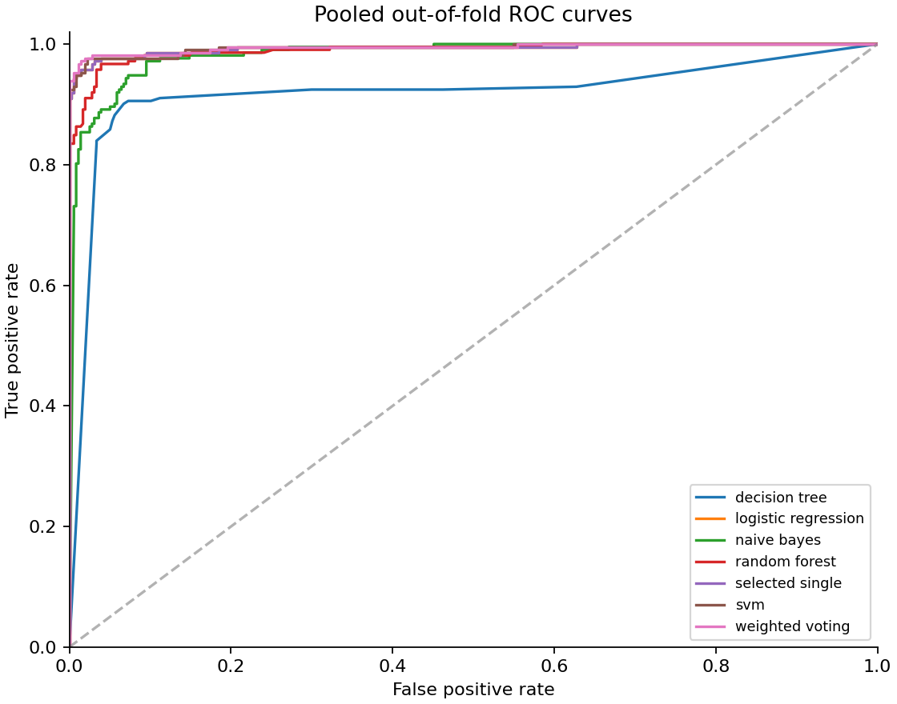
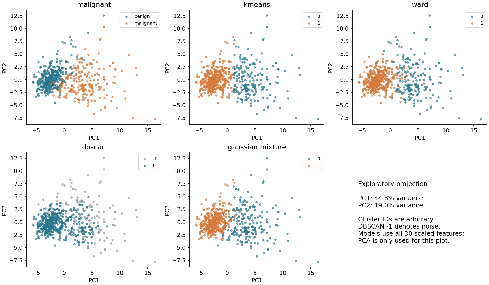

# Nested cross-validation results

This run uses 569 WDBC observations and 30 features.
The positive class is malignant (1); benign is 0. Classification uses a fixed
probability threshold of 0.5. The outer and inner fold counts are
5 and 3; the random seed is 42.

## Classification

Values are the unweighted means and sample standard deviations across outer folds.
They are not training scores or independent external-validation estimates.

| model | accuracy | roc_auc | f1_malignant | recall_malignant |
| --- | --- | --- | --- | --- |
| weighted_voting | 0.9772 ± 0.0133 | 0.9954 ± 0.0060 | 0.9688 ± 0.0188 | 0.9578 ± 0.0447 |
| selected_single | 0.9737 ± 0.0186 | 0.9952 ± 0.0059 | 0.9633 ± 0.0268 | 0.9436 ± 0.0587 |
| logistic_regression | 0.9737 ± 0.0186 | 0.9952 ± 0.0059 | 0.9633 ± 0.0268 | 0.9436 ± 0.0587 |
| svm | 0.9737 ± 0.0124 | 0.9950 ± 0.0064 | 0.9644 ± 0.0168 | 0.9621 ± 0.0398 |
| random_forest | 0.9543 ± 0.0114 | 0.9912 ± 0.0060 | 0.9382 ± 0.0163 | 0.9341 ± 0.0558 |
| naive_bayes | 0.9297 ± 0.0223 | 0.9848 ± 0.0087 | 0.9045 ± 0.0284 | 0.8916 ± 0.0541 |
| decision_tree | 0.9209 ± 0.0151 | 0.9218 ± 0.0258 | 0.8924 ± 0.0206 | 0.8822 ± 0.0602 |

`selected_single` selects one of the five model families in each outer fold using
only inner-CV ROC AUC. It is a model-selection procedure, not one fixed model.
`weighted_voting` selects weights for fixed logistic-regression, SVM and random-forest
members using inner CV. The candidate grids are saved in `searches.json`.

## Does probability-weighted voting help?

The paired differences below are voting minus `selected_single` on the same outer folds.

- accuracy: mean difference +0.0035; voting was higher in 2/5 folds.
- roc_auc: mean difference +0.0002; voting was higher in 2/5 folds.
- f1_malignant: mean difference +0.0055; voting was higher in 2/5 folds.
- recall_malignant: mean difference +0.0142; voting was higher in 2/5 folds.

These are descriptive differences. Five overlapping CV training sets do not provide
five independent experiments. No statistical-significance or clinical-benefit claim
is made. The ensemble is retained even if it underperforms.

ROC curves pool cross-fitted probabilities for visualization; the table averages
fold-level AUC values, which need not equal the pooled AUC.

## Random-forest feature analysis

The table averages importances across outer folds. Permutation importance measures
the decrease in outer-fold AUC when a feature is shuffled. It is computed after
fitting and is not used for feature selection. Correlated predictors can share or
mask importance; these rankings do not establish causal or clinical importance.

| feature | impurity_importance | permutation_auc_decrease |
| --- | --- | --- |
| worst area | 0.13851 | 0.00368 |
| worst perimeter | 0.15275 | 0.00268 |
| area error | 0.03249 | 0.00192 |
| worst concave points | 0.11542 | 0.00181 |
| worst texture | 0.01604 | 0.00179 |
| mean texture | 0.01273 | 0.00168 |
| mean area | 0.04423 | 0.00118 |
| worst radius | 0.06967 | 0.00117 |
| mean radius | 0.05214 | 0.0011 |
| mean perimeter | 0.05951 | 0.001 |

## Exploratory clustering

These analyses use all samples and are not out-of-sample classification results.
Features are standardized before clustering; PCA is a display projection only.
The IQR analysis counts unusual values and does not delete or replace observations.
DBSCAN metrics exclude noise observations and must be read together with coverage;
they are not directly comparable to full-coverage metrics. Diagnosis labels are
used only for post-hoc comparison with cluster assignments, not fitting.
N/A means that fewer than two non-noise clusters were available for these metrics.

| model | clusters_excluding_noise | coverage | noise_samples | silhouette | calinski_harabasz | davies_bouldin | ari_non_noise |
| --- | --- | --- | --- | --- | --- | --- | --- |
| kmeans | 2 | 1.0 | 0 | 0.345 | 267.6964 | 1.3123 | 0.6707 |
| ward | 2 | 1.0 | 0 | 0.3394 | 248.6288 | 1.37 | 0.575 |
| dbscan | 1 | 0.7873 | 121 | N/A | N/A | N/A | N/A |
| gaussian_mixture | 2 | 1.0 | 0 | 0.3145 | 247.2835 | 1.377 | 0.774 |

## Reproduction and interpretation

- `metadata.json`: software versions, dataset hash, code hashes and run settings.
- `splits.json`: outer and inner sample indices; inner indices use global row numbers.
- `searches.json`: selected hyperparameters, candidate scores and selected single-model families.
- `predictions.csv`: one outer-test probability per sample and evaluated method.
- CSVs preserve 17 significant digits. When reloading with pandas, use
  `pd.read_csv(path, float_precision="round_trip")` to preserve near-equal
  probabilities and their ordering for AUC / average-precision calculations.
- `fold_metrics.csv` and `paired_differences.csv`: per-fold values for direct comparison.
- This is a small, previously studied public dataset. Nested CV repairs the evaluation
  procedure but does not create a new external cohort or remove earlier familiarity
  with the dataset. Results support a methodological course project, not a deployed
  diagnostic system.
